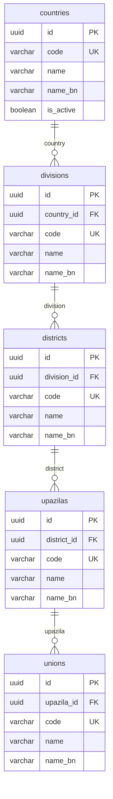
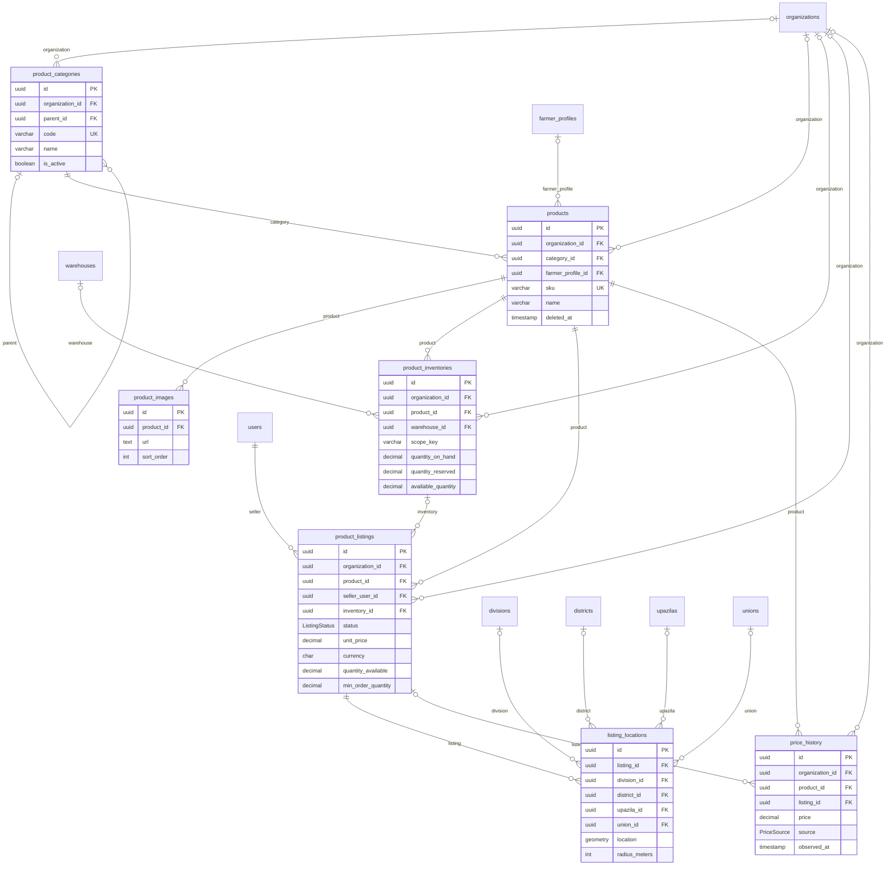
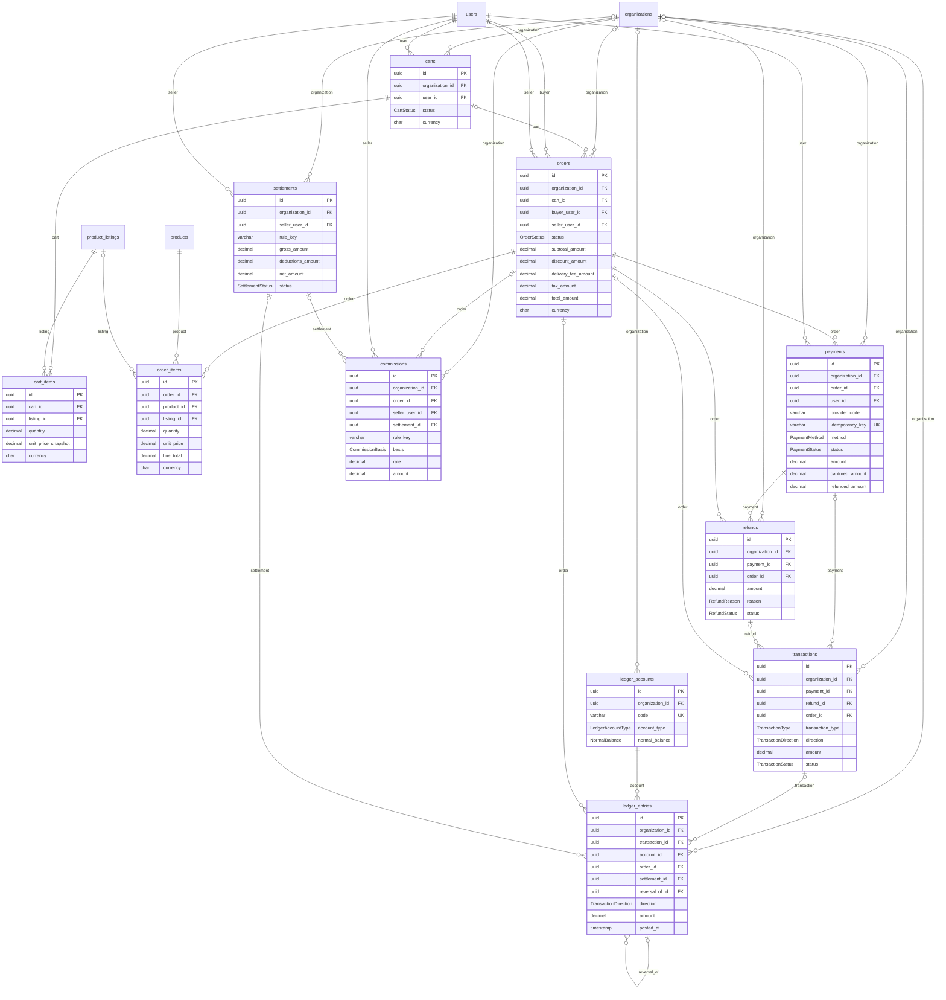
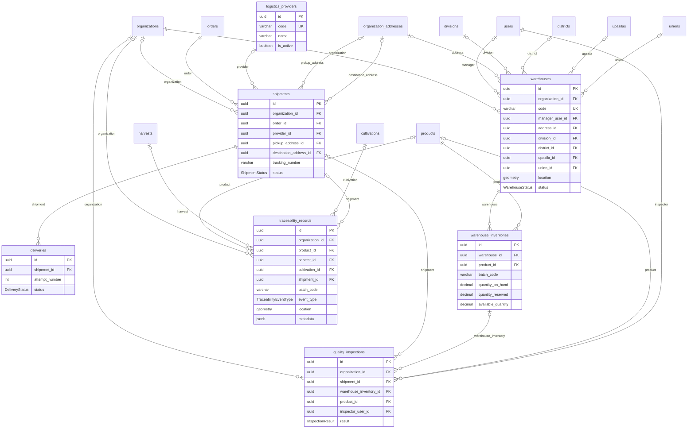
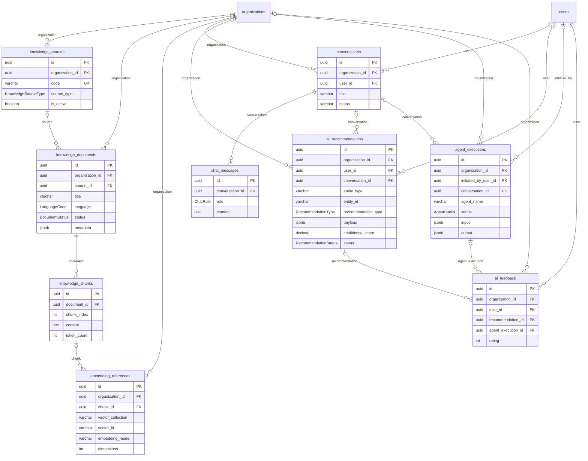
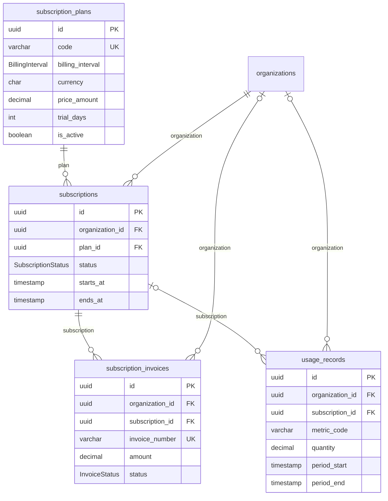
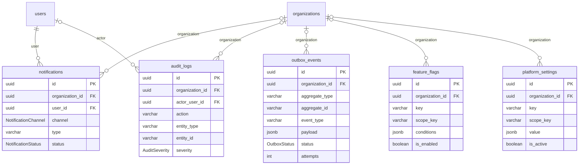

# Entity-relationship diagram

Entity names are the `@@map` table names from [`schema.prisma`](../../apps/api/prisma/schema.prisma). Attribute lists are abbreviated to primary keys, foreign keys, and representative business columns; the complete column list is in the schema.

Cardinality notation follows Mermaid: `||` = exactly one, `o|` / `|o` = zero or one, `o{` / `}o` = zero or more. The marker beside an entity describes how many rows of **that** entity relate to one row on the other side. Optional FKs are drawn as `|o--o{`; required FKs as `||--o{`. Relationship labels use the Prisma relation/FK names.

## Geography



## Identity and organization

```mermaid
erDiagram
  users {
    uuid id PK
    varchar email
    varchar phone UK
    text password_hash
    AccountStatus account_status
    boolean is_email_verified
    boolean is_phone_verified
    int failed_login_attempts
  }
  user_profiles {
    uuid id PK
    uuid user_id FK
    varchar first_name
    varchar last_name
    varchar name_bn
    varchar avatar_url
    date date_of_birth
    Gender gender
    varchar national_id_hash UK
    PreferredLanguage preferred_language
    char default_currency
  }
  roles {
    uuid id PK
    varchar code UK
    RoleScope scope
    boolean is_system
  }
  permissions {
    uuid id PK
    varchar code UK
    varchar resource
    varchar action
  }
  user_roles {
    uuid id PK
    uuid user_id FK
    uuid role_id FK
    uuid organization_id FK
    varchar scope_key
    uuid granted_by_user_id FK
  }
  role_permissions {
    uuid id PK
    uuid role_id FK
    uuid permission_id FK
  }
  sessions {
    uuid id PK
    uuid user_id FK
    varchar session_token_hash UK
    timestamp expires_at
  }
  refresh_tokens {
    uuid id PK
    uuid user_id FK
    uuid session_id FK
    varchar token_hash UK
    uuid rotated_to_id FK
  }
  otp_verifications {
    uuid id PK
    uuid user_id FK
    OtpPurpose purpose
    varchar code_hash
    timestamp expires_at
  }
  organizations {
    uuid id PK
    varchar slug UK
    uuid owner_user_id FK
    OrganizationType organization_type
    VerificationStatus verification_status
    varchar verification_note
    timestamp verified_at
    uuid verified_by_user_id FK
    varchar contact_email
    varchar contact_phone
    text description
    varchar website
    OrganizationStatus status
    char default_currency
    timestamp deleted_at
  }
  organization_members {
    uuid id PK
    uuid organization_id FK
    uuid user_id FK
    OrganizationMemberStatus status
  }
  organization_invitations {
    uuid id PK
    uuid organization_id FK
    varchar email
    uuid role_id FK
    uuid invited_by_user_id FK
    varchar token_hash UK
    InvitationStatus status
    timestamp expires_at
    timestamp accepted_at
  }
  organization_addresses {
    uuid id PK
    uuid organization_id FK
    varchar label
    uuid division_id FK
    uuid district_id FK
    uuid upazila_id FK
    uuid union_id FK
    geometry location
    boolean is_primary
  }
  organization_documents {
    uuid id PK
    uuid organization_id FK
    uuid uploaded_by_user_id FK
    OrganizationDocumentType document_type
    varchar file_name
    text file_url
    VerificationStatus verification_status
  }
  user_addresses {
    uuid id PK
    uuid user_id FK
    varchar label
    uuid division_id FK
    uuid district_id FK
    uuid upazila_id FK
    uuid union_id FK
    geometry location
    boolean is_primary
  }
  notification_preferences {
    uuid id PK
    uuid user_id FK
    NotificationChannel channel
    varchar event_type
    boolean enabled
  }
  role_profile_extensions {
    uuid id PK
    uuid user_id FK
    varchar role_code
    uuid organization_id FK
    varchar scope_key
    jsonb data
  }

  users ||--o| user_profiles : user
  users ||--o{ user_roles : user
  roles ||--o{ user_roles : role
  organizations |o--o{ user_roles : organization
  users |o--o{ user_roles : granted_by
  roles ||--o{ role_permissions : role
  permissions ||--o{ role_permissions : permission
  users ||--o{ sessions : user
  sessions |o--o{ refresh_tokens : session
  users ||--o{ refresh_tokens : user
  refresh_tokens |o--o{ refresh_tokens : rotated_to
  users |o--o{ otp_verifications : user
  users ||--o{ organizations : owner
  users |o--o{ organizations : verified_by
  organizations ||--o{ organization_members : organization
  users ||--o{ organization_members : user
  organizations ||--o{ organization_invitations : organization
  roles ||--o{ organization_invitations : role
  users ||--o{ organization_invitations : invited_by
  organizations ||--o{ organization_addresses : organization
  divisions |o--o{ organization_addresses : division
  districts |o--o{ organization_addresses : district
  upazilas |o--o{ organization_addresses : upazila
  unions |o--o{ organization_addresses : union
  organizations ||--o{ organization_documents : documents
  users ||--o{ organization_documents : uploaded_by
  users ||--o{ user_addresses : user
  divisions |o--o{ user_addresses : division
  districts |o--o{ user_addresses : district
  upazilas |o--o{ user_addresses : upazila
  unions |o--o{ user_addresses : union
  users ||--o{ notification_preferences : user
  users ||--o{ role_profile_extensions : user
  organizations |o--o{ role_profile_extensions : organization
```



`users.email` is nullable for phone-only accounts; uniqueness is enforced by
`users_email_not_null_key`, a partial index over non-null values. `OtpPurpose`
includes `ACCOUNT_RECOVERY` for locked/deactivated account recovery. Profile
verification status is derived from the `users` email/phone flags;
`user_profiles` has no verification column.

`organization_documents` stores metadata only; file bytes and storage providers
are external. `notification_preferences` is unique per user/channel/event.
`role_profile_extensions` is unique per user/role/scope and its raw check
requires `PLATFORM` with a null organization or the organization UUID repeated
in `scope_key`. Farmer agricultural data remains in `farmer_profiles` rather
than a `FARMER` role extension. Partial unique indexes keep one primary address
per user and per organization.

`refresh_tokens.rotated_to_id` is the single self-FK; Prisma exposes the inverse side as `rotated_from`.

## Agriculture

```mermaid
erDiagram
  farmer_profiles {
    uuid id PK
    uuid user_id FK
    uuid organization_id FK
    varchar farmer_code UK
    VerificationStatus verification_status
    decimal farm_size_hectares
    uuid primary_crop_id FK
  }
  farms {
    uuid id PK
    uuid organization_id FK
    uuid owner_user_id FK
    varchar name
    text description
    varchar code UK
    FarmType farm_type
    FarmStatus status
    AreaUnit area_unit
    decimal area_value
    decimal total_area_hectares
    LandOwnership ownership_type
    varchar ownership_reference
    uuid operator_user_id FK
    varchar operator_name
    varchar operator_phone
    varchar operator_email
    timestamp operating_since
    uuid farmer_profile_id FK
  }
  farm_locations {
    uuid id PK
    uuid farm_id FK
    uuid division_id FK
    uuid district_id FK
    uuid upazila_id FK
    uuid union_id FK
    geometry location
    geometry boundary
  }
  land_parcels {
    uuid id PK
    uuid organization_id FK
    uuid farm_id FK
    varchar code
    AreaUnit area_unit
    decimal area_value
    decimal area_hectares
    LandOwnership ownership_type
    LandParcelStatus status
    geometry boundary
  }
  farm_soil_profiles {
    uuid id PK
    uuid organization_id FK
    uuid farm_id FK UK
    varchar soil_type
    FarmSoilTexture texture
    decimal ph
    decimal organic_matter_percent
    SoilFertility fertility
    varchar drainage
    timestamp tested_at
    varchar testing_lab
    text notes
  }
  farm_irrigations {
    uuid id PK
    uuid organization_id FK
    uuid farm_id FK
    varchar code
    IrrigationSource source
    IrrigationMethod method
    IrrigationStatus status
    decimal capacity_liters_per_minute
    decimal command_area_hectares
    int frequency_per_week
    text notes
  }
  crops {
    uuid id PK
    varchar code UK
    CropCategory category
    boolean is_active
  }
  crop_varieties {
    uuid id PK
    uuid crop_id FK
    varchar code
    int maturity_days
  }
  crop_seasons {
    uuid id PK
    uuid organization_id FK
    varchar code UK
    int start_month
    int end_month
  }
  crop_calendars {
    uuid id PK
    uuid organization_id FK
    varchar scope_key
    uuid crop_id FK
    uuid crop_variety_id FK
    varchar code
    int sowing_start_month
    int sowing_end_month
    int harvest_days_min
    int harvest_days_max
    boolean is_active
  }
  agronomic_recommendations {
    uuid id PK
    uuid organization_id FK
    varchar scope_key
    uuid crop_id FK
    uuid crop_variety_id FK
    uuid calendar_id FK
    varchar code
    RecommendationSource source
    decimal confidence
    varchar rule_key
    timestamp valid_from
    timestamp valid_until
    boolean is_active
  }
  cultivations {
    uuid id PK
    uuid organization_id FK
    uuid farm_id FK
    uuid land_parcel_id FK
    uuid crop_variety_id FK
    uuid crop_season_id FK
    uuid crop_calendar_id FK
    uuid crop_id FK
    varchar code
    CultivationStatus status
    timestamp sown_at
    timestamp planted_at
    timestamp expected_harvest_at
    timestamp harvested_at
    GrowthStage growth_stage
    decimal area_hectares
    decimal expected_yield_kg
  }
  farm_activities {
    uuid id PK
    uuid organization_id FK
    uuid farm_id FK
    uuid cultivation_id FK
    uuid land_parcel_id FK
    uuid input_id FK
    uuid performed_by_user_id FK
    FarmActivityType activity_type
    timestamp activity_date
    GrowthStage growth_stage
    ObservationSeverity observation_severity
    decimal quantity
    varchar unit_code
    decimal cost_amount
    char currency
  }
  harvests {
    uuid id PK
    uuid organization_id FK
    uuid cultivation_id FK
    uuid farm_id FK
    decimal quantity_kg
    HarvestStatus status
  }
  farm_expenses {
    uuid id PK
    uuid organization_id FK
    uuid farm_id FK
    uuid cultivation_id FK
    ExpenseCategory category
    ExpenseSource source
    timestamp expense_date
    decimal amount
    char currency
    varchar receipt_url
    varchar estimate_rule_key
    decimal confidence
  }
  agricultural_inputs {
    uuid id PK
    uuid organization_id FK
    varchar code UK
    AgriculturalInputCategory category
    varchar unit_code
    boolean is_active
  }

  users ||--o| farmer_profiles : user
  organizations |o--o{ farmer_profiles : organization
  crops |o--o{ farmer_profiles : primary_crop
  users ||--o{ farms : owner
  users |o--o{ farms : operator
  organizations |o--o{ farms : organization
  farmer_profiles |o--o{ farms : farmer_profile
  farms ||--o| farm_locations : farm
  divisions |o--o{ farm_locations : division
  districts |o--o{ farm_locations : district
  upazilas |o--o{ farm_locations : upazila
  unions |o--o{ farm_locations : union
  organizations |o--o{ land_parcels : organization
  farms ||--o{ land_parcels : farm
  organizations |o--o{ farm_soil_profiles : organization
  farms ||--o| farm_soil_profiles : soil_profile
  organizations |o--o{ farm_irrigations : organization
  farms ||--o{ farm_irrigations : irrigation
  crops ||--o{ crop_varieties : crop
  organizations |o--o{ crop_seasons : organization
  organizations |o--o{ crop_calendars : organization
  crops ||--o{ crop_calendars : crop
  crop_varieties |o--o{ crop_calendars : crop_variety
  organizations |o--o{ agronomic_recommendations : organization
  crops ||--o{ agronomic_recommendations : crop
  crop_varieties |o--o{ agronomic_recommendations : crop_variety
  crop_calendars |o--o{ agronomic_recommendations : calendar
  organizations |o--o{ cultivations : organization
  farms ||--o{ cultivations : farm
  land_parcels |o--o{ cultivations : land_parcel
  crop_varieties ||--o{ cultivations : crop_variety
  crop_seasons |o--o{ cultivations : crop_season
  crop_calendars |o--o{ cultivations : crop_calendar
  crops |o--o{ cultivations : crop
  organizations |o--o{ farm_activities : organization
  farms ||--o{ farm_activities : farm
  cultivations |o--o{ farm_activities : cultivation
  land_parcels |o--o{ farm_activities : land_parcel
  agricultural_inputs |o--o{ farm_activities : input
  users |o--o{ farm_activities : performed_by
  organizations |o--o{ harvests : organization
  cultivations ||--o{ harvests : cultivation
  farms ||--o{ harvests : farm
  organizations |o--o{ farm_expenses : organization
  farms ||--o{ farm_expenses : farm
  cultivations |o--o{ farm_expenses : cultivation
  organizations |o--o{ agricultural_inputs : organization
```

`farm_locations.farm_id` is also `UNIQUE` (one location per farm), and all foreign-key columns use `snake_case`. Farm and parcel areas store both the submitted `area_unit`/`area_value` and a canonical `area_hectares` (`total_area_hectares` on farms); allowed units are `HECTARE`, `ACRE`, and `SQUARE_METER`. `farm_soil_profiles.farm_id` is unique (one profile per farm), while `farm_irrigations` is unique on `(farm_id, code)` and holds multiple records per farm. Soil and irrigation rows repeat `organization_id` and are covered by the same tenant-match and farm tenant-immutability triggers as parcels.

`crop_calendars` and `agronomic_recommendations` are unique on `(scope_key, code)`, and cultivations are unique on `(farm_id, code)`. `scope_key` is `GLOBAL` only when `organization_id` is null; tenant rows use the organization UUID as both values. Cultivations and expenses carry `organization_id` from their farm, and constraint triggers reject mixed crop/variety pairs, mismatched recommendation calendars, and tenant reassignment while expenses still reference the old tenant. `farm_expenses.source` separates `RECORDED` actual costs from `AI_ESTIMATED` values; estimates require `estimate_rule_key`, while recorded rows must not carry estimate metadata. A cultivation may omit `cultivation_id` on an expense, in which case the farm-level cost remains unallocated in per-cultivation reports.

## Marketplace



`product_categories.parent_id` is the self-FK; Prisma exposes the inverse side as `children`.

## Commerce



`ledger_entries.reversal_of_id` is the self-FK; Prisma exposes the inverse side as `reversals`.

## Logistics



## AI



## SaaS



## System and reliability



`platform_settings` has no relations other than its optional organization scope; business policies that are not yet decided are addressed by `key` + `scope_key` rather than hardcoded tables or values.
